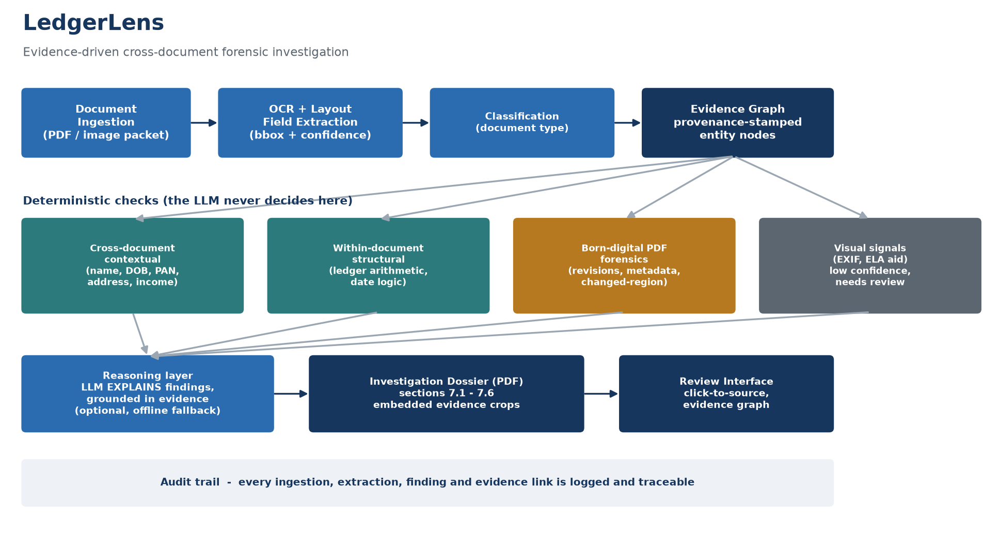

# LedgerLens

**Evidence-driven cross-document forensic investigation for financial document packets.**

LedgerLens is an AI-powered document forensics system built for the DataOps Innovation
Hackathon 2026 (Problem Statement 2). It goes beyond OCR and single-field validation: it
ingests a *packet* of related financial documents (a loan / KYC bundle), extracts every
field with provenance, builds an **evidence graph**, and investigates the packet for fraud
that only becomes visible when the documents are examined together. Every finding traces
back to the exact region of the exact source document, and every finding is labelled by
confidence and by whether it was *observed* or is only *potentially* a manipulation.



---

## The core idea

Most document-fraud tools chase an unreliable pixel-level verdict on one document ("is this
image tampered?"). Published benchmarks show those methods underperform badly on real
documents. LedgerLens inverts that: **fraud in a document packet hides between documents and
in structure, not in a single pixel.** So we lead with deterministic, explainable checks and
treat pixel-level visual forensics as a low-confidence aid, not a verdict.

- **The LLM explains, it never decides.** Every finding is produced by a deterministic
  check. The reasoning layer only phrases the explanation, grounded in the evidence.
- **Click-to-source traceability.** Every finding links to the exact bounding box on the
  source document.
- **Honest confidence.** Findings are tiered High / Medium / Low and labelled *observed
  inconsistency*, *potential manipulation*, or *needs human review*.

## What it detects

| Class | Examples | Reliability |
|-------|----------|-------------|
| Cross-document contextual | Name / DOB / PAN / address / employer conflicts across documents; declared income not supported by payroll and bank credits | High (deterministic) |
| Within-document structural | Bank-statement running balance that does not reconcile; identity issued after the application date | High (deterministic) |
| Born-digital PDF forensics | Incremental-update revisions after signing; creator/producer mismatch; the changed region localized by diffing PDF revisions | High (deterministic file structure) |
| Visual forensic | Photo-editor EXIF metadata; ELA heatmap aid | Medium / Low (flagged for human review, never "confirmed fraud") |

## Quick start

**Prerequisite:** the Tesseract OCR engine must be installed and on `PATH`
(Windows: install Tesseract 5.x; Linux: `apt-get install tesseract-ocr`; macOS: `brew install tesseract`).

```bash
python -m pip install -r requirements.txt

# 1. generate the synthetic demonstration dataset (genuine + manipulated packets)
python dataset/generate_dataset.py

# 2a. run the investigation from the command line (prints findings, writes the dossier)
python run_investigation.py --packet dataset/manipulated --out samples/sample_dossier.pdf

# 2b. or launch the review interface
streamlit run app.py
```

The pipeline is deterministic (fixed seed, no network), so the same inputs always produce the
same findings. An LLM phrasing step is optional and only activates if `ANTHROPIC_API_KEY` is
set; without it, grounded deterministic explanations are used, so results are fully reproducible offline.

## What the demo shows (manipulated packet)

The manipulated loan/KYC packet contains 8 planted anomalies; LedgerLens flags all 8 and
the genuine packet comes back clean (0 findings). See [`dataset/GROUND_TRUTH.md`](dataset/GROUND_TRUTH.md)
and [`samples/sample_dossier.pdf`](samples/sample_dossier.pdf).

## Repository layout

```
ledgerlens/
  app.py                     Streamlit review interface (the mandatory review UI)
  run_investigation.py       CLI: run pipeline + generate dossier
  ledgerlens/
    model.py                 data structures (Field, Evidence, Finding, confidence tiers)
    extract.py               OCR, layout-aware extraction, classification, ledger parsing
    graph.py                 evidence graph + cross-document contradiction detection
    checks.py                income, date-logic, arithmetic, PDF forensics, visual signals
    reasoning.py             investigation summary + optional LLM explanation
    dossier.py               investigation dossier (PDF), PS-2 sections 7.1 - 7.6
    viz.py                   evidence highlighting, graph image, ELA heatmap
    pipeline.py              orchestration + audit trail
  dataset/
    generate_dataset.py      synthetic genuine + manipulated packets, with ground truth
    GROUND_TRUTH.md          the planted anomalies
  docs/                      architecture, technical documentation, limitations, status
  samples/                   sample dossier (PDF + JSON)
```

## Technology and AI-tool disclosure

Built in Python with Tesseract (OCR), PyMuPDF (PDF structure and rendering), Pillow and
OpenCV-free NumPy (image analysis), reportlab (dossier PDF), NetworkX and Matplotlib
(evidence graph and diagrams), Streamlit (UI), and piexif (EXIF). An optional explanation
step can call the Anthropic Claude API. This project was developed with AI coding assistance;
all architecture, methods and technical decisions are the author's and can be explained in
full. See [`docs/technical_documentation.md`](docs/technical_documentation.md),
[`docs/implementation_status.md`](docs/implementation_status.md) and
[`docs/limitations_and_assumptions.md`](docs/limitations_and_assumptions.md).

## Ethics and safety

All demonstration documents are fully synthetic. No real person, PAN, account or photograph
is used. LedgerLens does not treat OCR output as ground truth, does not classify any anomaly
as confirmed fraud, separates observations from potential manipulation, and preserves human
oversight for every consequential decision.

## License

MIT, see [`LICENSE`](LICENSE). Author: Arnav Joshi.
